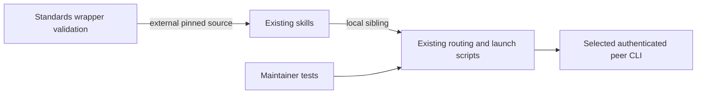
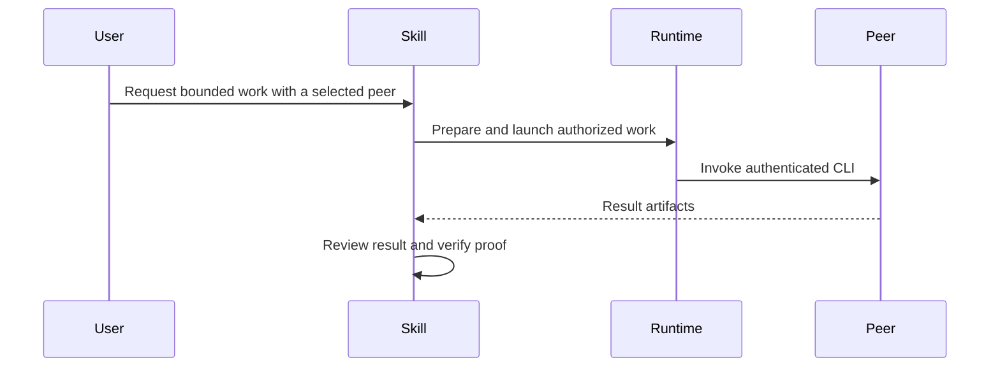

# Remove caller-declared peer export settings

## Intent

Remove the classification and approved-destination feature from Cowork. Keep
peer selection, authentication, bounded context, isolated writes and independent
verification intact. Existing skill triggers and descriptions remain unchanged.
No repository-specific approval record was found: the removed gate accepted
public/internal and the Copilot CLI identifier was copilot. These accepted
values were configuration, not proof of organizational approval.

## Components and dependencies

## Interface and composition

Skills retain their inputs, outputs, discovery triggers and dependencies.
Routing retains its CLI arguments and result artifacts, removing only the
classification/destination environment variables and their gate script.
Runtime scripts remain local siblings; tests and this packet are maintainer
artifacts. Standards retains its existing external repository dependency and
immutable pin mechanism. No new modules or dependencies are introduced.
Target existing Claude, Codex, Copilot and Anti-Gravity adapters; no portability
expansion. Sequential implementation plus validation suffices; no agent spawns.

## Design and cost checks

Apply R5 pruning, B4 persisted plan, B8 scope anchor and deterministic shell
verification. No dispatch redesign: trigger evaluations are unchanged.
Balanced cost stance; no extra model calls or paid evaluations. Runtime model
selection and output budgets remain unchanged for small, medium and repository
wide workloads; prompt overhead decreases by removing gate instructions.
No invented monetary estimate for user-selected providers.

## Validation and handoff

- Remove the isolated feature addition and verify the diff preserves other work.
- Run existing mock-backed routing, peer review/work, plugin, installation,
  model resolution, workflow, doctor and Rally contract suites.
- Exercise launches with both configuration variables absent; assert obsolete
  settings cannot block routing. Preserve authentication and isolation checks.
- Align Standards documentation and source-install validation using local source.
- Leave immutable dependency pin unchanged until a new revision is published;
  do not fabricate a SHA. Remote publication needs explicit user instruction.
- Review final diffs and report test limitations honestly. No reviewer requests.

Human rationale: caller-declared environment variables add repeated setup work
without verifying organizational approval. User requested removing this feature;
consumer policy and existing authorization rules remain independently applicable.

## Verification results

All ten existing suites passed after removing the export gate. The final
test fixtures no longer reference its removed environment settings. The router suite initially encountered an existing
macOS temporary-file collision; it passed with a fresh per-run TMPDIR without
runtime changes. Four APM local-source target combinations passed. Final diff
review and whitespace checks passed. No live peer was launched, no reviewer
was requested, and no changes were committed or pushed.

Standards alignment is prepared in its existing PR #93 checkout. Publication
and a real new immutable upstream pin remain outstanding; PR #96 is untouched.

## Model resolution extension

User additionally requires unrestricted model selection and forbids changing
opus-5.5 to claude-opus-5. Existing component and sequence diagrams still apply:
the runtime resolver sits between skills and selected peer. Keep live catalogs
as alias hints, not allowlists. Exact names win; alias matching must preserve
whole numeric versions. With an explicit peer, unmatched or ambiguous text
passes unchanged to that CLI, which validates availability. Without a peer,
require unambiguous peer discovery rather than guessing a destination.

Update resolver, affected skill instructions and regression tests. Exercise
missing catalog entries, ambiguous aliases, decimal versions, exact IDs, and
actual router forwarding with mock CLIs. No model catalog constants in runtime.
Cost, composition and invocation boundaries remain unchanged.

Model extension verification: resolver, setup, router and Rally contract suites
passed after the resolver change. Both direct model IDs and model-name queries
forward opus-5.5 unchanged to the mock Copilot CLI. Unknown catalog entries and
ambiguous aliases pass to the selected CLI, while missing peer selection still
requires unambiguous discovery. All four local APM target matrices passed again.
Searches found no removed classification/destination environment variable names
in Cowork, the Standards PR #93 checkout, or the original Standards checkout.
